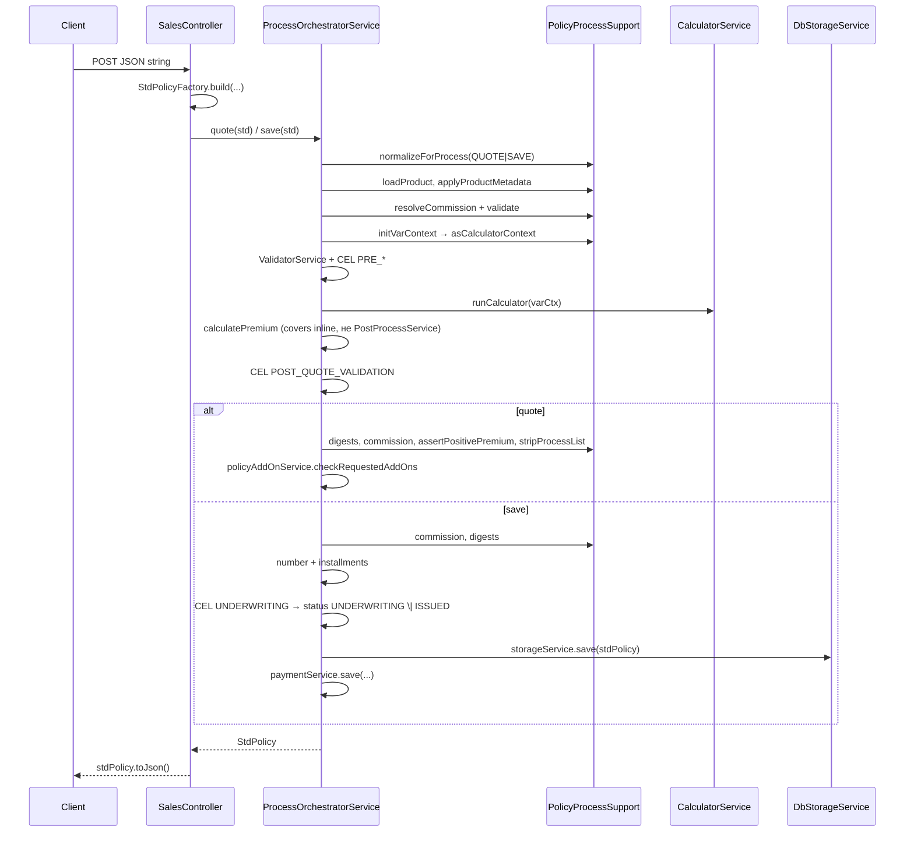
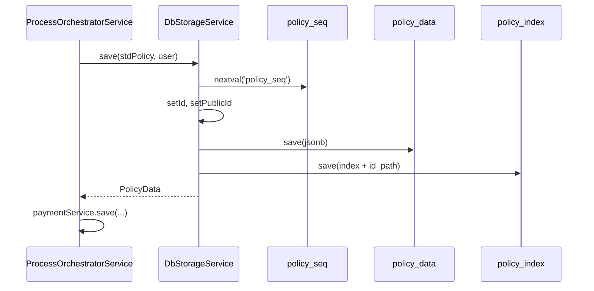

# Quote / Save: поток обработки договора

Документ описывает, как запросы **quote** (расчёт котировки) и **save** (оформление договора) проходят через API, оркестратор, калькулятор и хранилище; какие форматы данных используются на каждом этапе; как договор записывается в БД и читается обратно.

> **Статус (as-is).** Сверено с `ProcessOrchestratorService`, `PolicyProcessSupport`, `PreProcessService`, `SalesController` (pt-process / pt-launcher). План рефакторинга — § «Рефакторинг».

Pluggable wire-форматы и adapter-JAR: [POLICY_WIRE_ADAPTERS.md](./POLICY_WIRE_ADAPTERS.md).

---

## API-эндпоинты

| Метод | URL | Контроллер | Оркестратор |
|-------|-----|------------|-------------|
| `POST` | `/api/v1/{tenantCode}/sales/quotes` | `SalesController.quoteValidator` | `ProcessOrchestrator.quote(StdPolicy)` |
| `POST` | `/api/v1/{tenantCode}/sales/policies` | `SalesController.saveValidator` | `ProcessOrchestrator.save(StdPolicy)` |
| `GET` | `/api/v1/{tenantCode}/sales/policies/{policyNumber}` | `SalesController.getPolicyByNumber` | `ProcessOrchestrator.getPolicyByNumber` |

Тело запроса quote/save — **сырой JSON-строкой** (`@RequestBody String`).

Парсинг в контроллере:

```java
StdPolicy policy = stdPolicyFactory.build(StdPolicyFormat.INSURANCE_CONTRACT, requestBody);
String result = processOrchestrator.quote(policy).toJson(); // или .save(policy)
```

Ответ — JSON-строка (`stdPolicy.toJson()`).

`PolicyProcessSupport.parsePolicy` существует, но **в текущем HTTP-пути SalesController не вызывается** — парсинг дублируется в контроллере.

---

## Слои и пакеты

```
HTTP JSON string
    │
    ▼
SalesController (pt-launcher)
    │  StdPolicyFactory.build(INSURANCE_CONTRACT, json)
    ▼
ProcessOrchestratorService (pt-process)     ← оркестратор quote / save / payment / get
    ├── PolicyProcessSupport                ← normalize, product, commission, digests, strip
    ├── PreProcessService                   ← normalizePolicy, dates, covers из продукта
    ├── ValidatorService                    ← валидаторы продукта (QUOTE / SAVE)
    ├── RuleValidationService (CEL)         ← PRE_QUOTE / PRE_SAVE / POST_QUOTE / UNDERWRITING
    ├── CalculatorService (pt-calculator)   ← тарифный расчёт
    ├── PostProcessService                  ← setCovers (есть, но из quote/save сейчас НЕ вызывается)
    ├── NumberGeneratorService              ← только save
    ├── PaymentService                      ← только save (график платежей)
    ├── PolicyAddOnService                  ← только quote
    └── StorageService → DbStorageService   ← только save (pt-db)
```

### Форматы данных

| Слой | Тип | Назначение |
|------|-----|------------|
| Wire JSON | `ru.pt.api.dto.policyv3.PolicyDTO` | Схема API и JSON в БД |
| Домен процесса | `ru.pt.api.dto.policy.StdPolicy` | Единый интерфейс для quote/save/storage |
| Реализация | `InsuranceContractPolicy`* | Обёртка: `PolicyDTO` + runtime-переменные; `formatId` = `v3` |

\* целевое имя при рефакторинге: `V3Policy` в `pt-adapter-v3`.

| Domain-view | `ru.pt.api.dto.policy.*` (`InsuredObject`, `Cover`, `Commission`, …) | Типизированный доступ в оркестраторе |
| Переменные расчёта | `VariableContextImpl` (`CalculatorContext`) | JsonPath → vars, калькулятор, CEL |
| Хранилище | `PolicyData` + `policy_data` / `policy_index` | DTO передачи; JSONB + денормализованный индекс |

**Важно:** отдельного «std JSON»-формата нет. `StdPolicy` — Java-абстракция. В БД и в ответе API лежит **wire JSON** (`policyv3.PolicyDTO`), обогащённый процессом (премия, номер, id, commission, installments, status и т.д.).

---

## Общая схема (quote и save)



---

## Шаг 1. Парсинг запроса → StdPolicy

В HTTP-пути:

```java
// SalesController
stdPolicyFactory.build(StdPolicyFormat.INSURANCE_CONTRACT, requestBody)
```

Цепочка:

1. `StdPolicyRegistry` находит `InsuranceContractStdPolicyMapper`.
2. `InsuranceContractPolicy.fromJson(json)`:
   - `PolicyJsonSupport.fromJson(json)` → `PolicyDTO` (wire);
   - создаётся `InsuranceContractPolicy(contract, sourceJson)`.

На этом этапе `PolicyDTO` живёт **внутри** `InsuranceContractPolicy`. Оркестратор получает уже `StdPolicy`.

---

## Шаг 2. Нормализация (PreProcessService)

`PolicyProcessSupport.normalizeForProcess` → `preProcessService.normalizePolicy`:

| Поле / действие | Значение |
|-----------------|----------|
| `processList.processType` | `"quote"` или `"save"` |
| `processList.dataScope` | `DEV` или `PROD` по `user.dataScope` |
| `premium` | `null` (пересчитывается) |
| `policyNumber` | `null` (на save генерируется позже) |
| `productVersion` | `0` (перезапишется из продукта) |
| `id` | `null` |
| `statusCode` | `QUOTE`, если не был `ISSUED` |

Статусы домена (`PolicyStatus`): `QUOTE` → `UNDERWRITING` / `ISSUED` → `PAID`. Значения `NEW` / `IN_PAYMENT` в enum **нет**.

---

## Шаг 3. Продукт, авторизация, метаданные

Общие для quote и save:

1. **Продукт** — `productService.getProductByCode(tenantId, productCode, isDev)`.
2. **Авторизация:**
   - quote: `PRODUCT` + `AuthZ.Action.QUOTE`;
   - save (только если `dataScope == PROD`): `POLICY::SELL` + `checkProductAction(..., SELL)`.
3. **Метаданные** — `PreProcessService.applyProductMetadata`:
   - `productVersion`, `productName`;
   - нормализация дат (`issueDate`, `startDate`, `endDate`, `policyTerm`, waiting/activation);
   - инициализация покрытий/франшиз по пакету продукта.
4. **Страховщик** — `InsCompanyService` + `InsurerMapper` внутри `applyProductMetadata`.
5. **Комиссия** — `resolveCommission` + `validateRequestedCommission` (ставка через `CommissionService`).

---

## Шаг 4. Контекст переменных (VariableContext)

`PolicyProcessSupport.initVarContext`:

```java
policy.setVars(product);           // InsuranceContractPolicy.rebuildVariableContext()
CalculatorContext varCtx = policy.asCalculatorContext();
// enrichVariables больше не вызывается из initVarContext
```

Внутри `setVars`:

1. `syncViewsToContract()` — domain-view → `PolicyDTO`;
2. `sourceJson = PolicyJsonSupport.toJson(contract)`;
3. `VariableContextImpl.builder().json(sourceJson).productVersion(product).build()`:
   - по jsonPath из определений переменных продукта материализуются значения из JSON;
   - вычисляются MAGIC-переменные (`ph_age_issue`, `pl_TermMonths`, …).

Дальше оркестратор, калькулятор и CEL работают с `varCtx`.

---

## Шаг 5. Валидация

| Этап | quote | save |
|------|-------|------|
| `ValidatorService` QUOTE | ✓ | ✓ |
| `ValidatorService` SAVE | — | ✓ |
| CEL `PRE_QUOTE_VALIDATION` | ✓ | ✓ |
| CEL `PRE_SAVE_VALIDATION` | — | ✓ |
| CEL `POST_QUOTE_VALIDATION` | ✓ (после расчёта) | ✓ (после расчёта) |
| CEL `UNDERWRITING` | — | ✓ (после installments; не hard-fail) |
| Add-ons (`PolicyAddOnService`) | ✓ (в конце) | — |

Поведение UNDERWRITING на save:

* если CEL вернул сообщения → `statusCode = UNDERWRITING` (договор всё равно сохраняется);
* иначе → `statusCode = ISSUED`.

Ошибки Validator/CEL PRE/POST (кроме UNDERWRITING) → `BadRequestException` (400) со списком `ErrorDetail` из `ValidationError` (`throwValidationErrors`).

---

## Шаг 6. Расчёт премии (калькулятор)

`ProcessOrchestratorService.calculatePremium` (private, ~100 строк):

1. Ограничение: **ровно 1** `InsuredObject`, иначе `UnprocessableEntityException`.
2. Регистрация vars покрытий: `sumInsured` / `premium` / `deductibleNr` на каждый cover.
3. `calculatorService.getCalculator` + `runCalculator` по `packageCode` первого объекта.
4. Запись результатов **прямо в** `Cover` (sumInsured, premium, deductible + текст из продукта через `resolveDeductibleText`).
   - Вызов `postProcessService.setCovers(...)` **закомментирован** — логика частично дублирует `PostProcessService`, но с резолвом текста франшизы и без `limitMin`/`limitMax`.
5. Премия договора:
   - если `varCtx.pl_premium > 0` → `stdPolicy.setPremium(pl_premium)`;
   - иначе сумма `cover.premium`.
6. СС объекта — из `io_sumInsured`; при `<= 0` — ошибка тарифа.

`CalculatorServiceImpl.runCalculator` загружает модель (формулы, коэффициенты), добавляет CONST и выполняет строки формулы.

---

## Шаг 7. Постобработка

После расчёта:

1. **CEL POST_QUOTE_VALIDATION** (и quote, и save).
2. **Комиссия** — `policyProcessSupport.calculateCommission` → `stdPolicy.setCommission`.
3. **Digests** — `TextDocumentView` → `ph_digest` / `io_digest` в `processList` (`applyDigests`). Поле `insCompanyCode` в digests **не пишется**.
4. **quote only:** `assertPositivePremium`, `stripProcessListForProdResponse` (PROD → `processList=null`, DEV → vars в processList), add-ons.
5. **save only:** номер, installments, UNDERWRITING status, storage, payment save, `processList=null`.

---

## Шаг 8. Только save — оформление и запись

| # | Действие | Сервис / код |
|---|----------|--------------|
| 1 | Генерация номера | `NumberGeneratorService.getNextNumber` |
| 2 | Digests | `applyDigests` |
| 3 | График платежей | `PaymentService.createInstallments` → `stdPolicy.setInstallments` |
| 4 | CEL UNDERWRITING | статус `UNDERWRITING` или `ISSUED` |
| 5 | Сохранение в БД | `StorageService.save(stdPolicy, getCurrentUser())` |
| 6 | Сохранение платежей | `PaymentService.save(tenantId, policyId, installmentsDto)` |
| 7 | Ответ | `processList = null`, контроллер вызывает `toJson()` |

После `storageService.save` на `stdPolicy` проставлены `id` и `publicId` (нужны для `paymentService.save`).

`assertPositivePremium` на save **не вызывается**.

---

## Сериализация ответа (toJson)

`InsuranceContractPolicy.toJson()`:

1. `syncViewsToContract()` — domain views → `PolicyDTO`;
2. `PolicyJsonSupport.toJson(contract)` — Jackson, pretty-print, `@JsonInclude(NON_EMPTY)`.

`processList` в ответе:

* **quote + PROD** — убирается (`stripProcessListForProdResponse`);
* **quote + DEV** — остаётся, с vars;
* **save** — `setProcessList(null)` перед возвратом.

---

## Хранение в БД

Запись в БД — **только на save**. Quote не персистится.

Реализация: `StorageService` → `DbStorageService` (`pt-db`). Миграции — `pt-launcher/.../db/migration/`.

### Модель: две связанные таблицы

| Таблица | JPA-сущность | Назначение |
|---------|--------------|------------|
| `policy_data` | `PolicyEntity` | Полный документ (JSONB) |
| `policy_index` | `PolicyIndexEntity` | Денормализованный индекс |

Связь **1:1** по `id` (`policy_seq`), `policy_index.id` → `policy_data.id` `ON DELETE CASCADE`.

### Идентификаторы

| Поле | Где | Тип | Назначение |
|------|-----|-----|------------|
| `id` | обе таблицы | `BIGINT` | PK из `policy_seq` |
| `public_id` | `policy_index` | `UUID` | Внешний id (`publicId` в JSON, платежи) |
| `policy_nr` | index + JSON | `VARCHAR(30)` | Бизнес-номер; `UNIQUE (tid, policy_nr)` |

### Схема `policy_data`

| Колонка | Тип | Источник |
|---------|-----|----------|
| `id` | `BIGINT PK` | `policy_seq` |
| `tid` | `BIGINT` | `userData.getTenantId()` |
| `cid` | `BIGINT` | `userData.getClientId()` |
| `policy` | `JSONB` | `policy.toJson()` (без `processList`) |

### Схема `policy_index` (ключевые поля при save)

| Колонка | Источник |
|---------|----------|
| `id` / `public_id` / `tid` / `policy_nr` | id, UUID, tenant, номер |
| `document_format` | `policy.getFormat()` → `v3` |
| `product_code` / `product_version_no` | из договора |
| `user_account_id` / `client_account_id` / `id_path` | пользователь / иерархия |
| `data_scope` | `processList.dataScope` |
| `policy_status` | `PolicyStatus.valueOf(statusCode)` — после save обычно `ISSUED` или `UNDERWRITING` |
| `ins_company` | `insurer.code` |
| `ph_digest` / `io_digest` | из `processList` до обнуления |
| `premium` / agent KV | премия и commission |

`document_format` = `formatId` для `StdPolicyRegistry.fromStorage()`. См. [POLICY_WIRE_ADAPTERS.md](./POLICY_WIRE_ADAPTERS.md).

### Запись при save



Транзакция: `DbStorageService.save` не гарантирует атомарность data+index на уровне явного `@Transactional` в оркестраторе — при сбое между шагами возможна рассинхронизация.

### DTO `PolicyData`

| Поле | Содержимое |
|------|------------|
| `policyId` | `UUID` = `public_id` |
| `policyNumber` | `policy_nr` |
| `policyStatus` | из индекса |
| `policyIndex` | проекция индекса |
| `policy` | JSON-строка из `policy_data` |

---

## Чтение из БД

| Метод | Поиск |
|-------|-------|
| `getPolicyByNumber` | `policy_nr` |
| `getPolicyById` | `public_id` |
| `getPolicyByPaymentOrderId` | `payment_order_id` |
| `getAccountQuotes` | `id_path` + фильтры |

Оркестратор на get проверяет **точное** совпадение `userAccountId` и `clientAccountId` с текущим пользователем (не иерархия `isParent`). `403` при несовпадении.

### Callback оплаты

`paymentCallback(String policyId)` ожидает **UUID `publicId`**, грузит через `getPolicyById`, ставит `PAID` в JSON (`JsonSetter`) и в индексе, опционально email/SMS по `ClientConfiguration`.

Для `PaymentType.CASH` оркестратор асинхронно вызывает `paymentCallback(paymentData.getPolicyNumber())` — **номер договора, не UUID**: риск несовместимости с парсингом UUID в callback.

### Обновление

`updatePolicy` / `update(String)` — **заготовки** (`return null` / `""`). Сообщение об ошибке статуса всё ещё говорит про `'NEW'`, хотя проверка идёт на `PolicyStatus.QUOTE`.

---

## Сравнение quote и save

| | Quote | Save |
|---|-------|------|
| Метод оркестратора | `quote` | `save` |
| `processType` | `quote` | `save` |
| Auth | `PRODUCT::QUOTE` | PROD: `POLICY::SELL` + product SELL |
| Validator SAVE | нет | да |
| CEL PRE_SAVE | нет | да |
| CEL POST_QUOTE | да | да |
| CEL UNDERWRITING | нет | да → status |
| Add-ons | да | нет |
| Номер / installments / БД | нет | да |
| `assertPositivePremium` | да | нет |
| Итоговый status | остаётся `QUOTE` (в ответе) | `ISSUED` или `UNDERWRITING` |

---

## Ключевые классы

| Класс | Модуль | Роль |
|-------|--------|------|
| `SalesController` | pt-launcher | HTTP; parse JSON → StdPolicy |
| `ProcessOrchestratorService` | pt-process | Оркестрация + payment + get + CEL helpers |
| `PolicyProcessSupport` | pt-process | Общие шаги pipeline |
| `PreProcessService` | pt-process | Normalize, даты, покрытия продукта |
| `CalculatorServiceImpl` | pt-calculator | Тарифные формулы |
| `PostProcessService` | pt-process | Vars → Cover (**не в hot path**) |
| `InsuranceContractPolicy` | pt-api | StdPolicy impl |
| `DbStorageService` / `PolicyMapper` | pt-db | Persistence |
| `StdPolicyFactory` / registry | pt-api / pt-process | Wire ↔ StdPolicy |

---

## Границы ответственности PolicyDTO

`PolicyDTO` (`policyv3`) — только **wire**:

* входящий/исходящий JSON;
* JSON в `policy_data.policy`;
* внутреннее поле `InsuranceContractPolicy.contract`.

Оркестратор и storage API работают с **`StdPolicy`**. Domain-типы синхронизируются в `PolicyDTO` перед `toJson`.

---

## Анализ ProcessOrchestratorService

### Что делает хорошо

* Явный pipeline quote/save с пошаговым timing (`logProcessStep`).
* Вынос части шагов в `PolicyProcessSupport`.
* Разделение product validators и CEL rules.
* Save: номер → installments → underwriting status → storage → payments.

### Проблемы (as-is)

| # | Проблема | Где |
|---|----------|-----|
| 1 | God-object: quote/save + premium + CEL bridge + payment + get/update stubs в одном классе (~800 строк) | весь сервис |
| 2 | Дублирование pipeline quote ≈ save (~70% одинаковых шагов) | `quote` / `save` |
| 3 | `calculatePremium` дублирует `PostProcessService.setCovers` (без limitMin/Max; с deductible text) | private method |
| 4 | Ограничение 1 insured object зашито в оркестратор | `calculatePremium` |
| 5 | CEL activation (`buildCelVariables` / numeric defaults) раздувает оркестратор | private helpers |
| 6 | `payment` / `paymentCallback` / email / async pool — другой bounded context | низ файла |
| 7 | `ExecutorService` cached, без shutdown / без передачи MDC/SecurityContext | `payment` CASH |
| 8 | CASH callback передаёт `policyNumber` в метод, ожидающий UUID | `payment` → `paymentCallback` |
| 9 | Get-доступ: exact account match, не hierarchy / actingAccount | `getPolicyBy*` |
| 10 | `update` / `createAddendum` / `updatePolicy` — stubs; путаница NEW vs QUOTE | stubs |
| 11 | Повторный `getCurrentUser()` на save в `storageService.save` | `save` |
| 12 | Парсинг JSON в контроллере и отдельно `parsePolicy` в support | SalesController vs Support |
| 13 | Валидация → 400 `BadRequest`, хотя часть ошибок — бизнес/тариф (часто ждут 422) | `throwValidationErrors` |
| 14 | Save без `assertPositivePremium` | `save` |
| 15 | Нет единой транзакции вокруг storage + payment save | `save` |
| 16 | Лишние / неиспользуемые imports; `ObjectMapper` локальный writer | класс |

---

## Рефакторинг — план

### Фаза 0. Документация и инварианты (сделано здесь)

* Зафиксировать as-is поток, статусы, CEL UNDERWRITING, отсутствие PostProcess в hot path.
* Критерии готовности: этот документ = source of truth для quote/save.

### Фаза 1. Безопасность и дефекты (высокий приоритет)

1. Исправить CASH → `paymentCallback`: передавать `publicId` (UUID), не `policyNumber`.
2. Пробросить SecurityContext / MDC в async executor или заменить на sync/event.
3. Выровнять get-доступ с AuthZ hierarchy (`actingAccountId` / `isParent`), не только exact match.
4. Добавить `assertPositivePremium` (или явное решение «не нужно») на save.
5. `@Transactional` на save path (storage + payment) либо outbox.

**Критерий:** CASH payment и get policy не ломают статусы/доступ; save атомарнее.

### Фаза 2. Разрезка оркестратора (структура)

Вынести из `ProcessOrchestratorService`:

| Новый компонент | Содержимое |
|-----------------|------------|
| `QuoteSavePipeline` (или template method) | общий pre: normalize → product → auth → commission → vars → validate → calc → postQuote CEL |
| `PremiumCalculationService` | `calculatePremium` + `resolveDeductibleText` + total premium; внутри вызывать/расширить `PostProcessService` |
| `CelValidationBridge` | `buildCelVariables`, `runCelValidation`, `throwValidationErrors` |
| `PaymentProcessService` | `payment`, `paymentCallback`, email/SMS |
| `PolicyQueryService` | `getPolicyById/Number` + access check |

Оркестратор остаётся тонким фасадом `ProcessOrchestrator`.

**Критерий:** файл оркестратора < ~200 строк; quote/save читаются как список шагов.

### Фаза 3. Унификация quote/save

1. Общий `runPricingPipeline(ProcessType, StdPolicy)` с различиями через strategy/flags:
   - validators set, CEL set, auth action, post-steps.
2. Единая точка parse: либо только контроллер, либо фильтр/resolver — удалить мёртвый дубль.
3. Вернуть `PostProcessService` в hot path: limits + deductible text в одном месте.

**Критерий:** изменение шага валидации/комиссии правится один раз.

### Фаза 4. Статусы и update path

1. Довести `updatePolicy` под `QUOTE` (сообщения, персист) или удалить из API.
2. Согласовать enum/docs: нет `NEW`/`IN_PAYMENT` в `PolicyStatus`.
3. Явно задокументировать UNDERWRITING как soft-gate (save всё равно пишет в БД).

### Фаза 5. Мультиобъектность и форматы (позже)

1. Снять hard-limit `insuredObjects.size() == 1` с калькулятора/оркестратора.
2. Wire adapters — по [POLICY_WIRE_ADAPTERS.md](./POLICY_WIRE_ADAPTERS.md).

---

### Рекомендуемый порядок внедрения

```text
1 (баги payment/access/premium)
    → 2 (вынести Premium + CEL + Payment + Query)
        → 3 (общий pipeline quote/save)
            → 4 (update/status)
                → 5 (multi-IO / adapters)
```

Не начинать фазу 3 до зелёных регрессионных сценариев quote+save+CASH callback после фазы 1–2.
