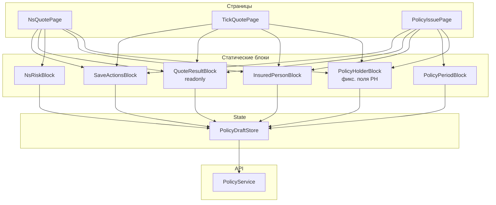

# Pre-project: набор форм ввода договора (PoliTechFront)

См. также:
- [flat-vars-wire-format-preproject.md](./flat-vars-wire-format-preproject.md) — плоский wire JSON `{ varCode: value }`
- [POLICY_QUOTE_SAVE.md](../../PoliTechAPI/docs/POLICY_QUOTE_SAVE.md) — quote/save на backend
- [validations.md](./validations.md) — валидаторы продукта

---

## 1. Цель

Добавить в **PoliTechFront** область **`features/policy-entry/`** — набор **статических** composable-форм для ввода страхового договора:

- каждый UI-блок — **отдельный Angular-компонент** с **фиксированным набором полей** в шаблоне;
- блок мапится на **фрагмент стандартного договора** (`INSURANCE_CONTRACT` / `Policy` / `BoxPolicy`);
- **страница** — композиция блоков;
- примеры: расчёт НС, расчёт «Антиклещ», ввод страхователя, период, оформление.

JSON-конфиг страниц и детали API — **отдельным этапом** (приложат позже).

---

## 2. Принятые решения

| # | Решение |
|---|---------|
| 1 | **`formly-forms` не используется** — модуль будет **удалён** из проекта |
| 2 | **Видимость полей не динамическая** — нет `product.vars`, `getFieldVisible`, `hideIfNoVars` |
| 3 | **Компоненты статические** — состав полей зашит в HTML/TS каждого блока |
| 4 | Каждый блок **отображает и редактирует** свой slice общего draft договора |
| 5 | Состав страницы = **явный список блоков** (TypeScript-конфиг, позже JSON) |

---

## 3. As-is (что убираем / что оставляем)

### 3.1 `features/formly-forms/` — **удалить**

| Было | Решение |
|------|---------|
| Монолит ~900 строк | Не переносить, не оборачивать |
| Route `product/.../form` | Удалить; заменить на `policy-entry` routes |
| Динамическая видимость по `product.vars` | **Не использовать** в новой архитектуре |

### 3.2 Что переиспользуем из shared

| Компонент | Использование |
|-----------|---------------|
| `BoxPolicy`, `Policy`, box-модели | UI-state draft |
| `PolicyService` | `conversBox2Policy`, `fastCalc`, `savePolicy` |
| Material UI | `mat-form-field`, `mat-datepicker`, `mat-select` |

**Не используем:** `FormlyFormsService`, `UiProductData.lists` для построения формы, `getFieldVisible`.

### 3.3 Backend

- Quote/save: `POST /api/v1/{tenant}/sales/quotes|policies` (nested JSON).
- В перспективе: flat `vars` (см. flat-vars preproject).

---

## 4. To-be: архитектура

### 4.1 Принципы

1. **Один draft на страницу** — `PolicyDraftStore` (`BoxPolicy` + meta).
2. **Блок = статический компонент** — фиксированные поля, labels в шаблоне.
3. **Блок мапится на slice договора** — read/write через store.
4. **Страница = список блоков** — какие блоки показать, решает конфиг страницы, не продукт.
5. **Переиспользование** — один `PolicyHolderBlock` на разных страницах (НС, Антиклещ).

### 4.2 Слои



**Нет связи blocks → ProductService.vars.** Продукт нужен только для `productCode`, quote/save и опционально example JSON.

---

## 5. Структура папок

```text
PoliTechFront/src/app/features/policy-entry/
├── index.ts
├── models/
│   ├── policy-page-config.model.ts
│   └── policy-draft-meta.model.ts
├── state/
│   └── policy-draft.store.ts
├── mappers/
│   ├── policy-holder.mapper.ts
│   ├── insured-object.mapper.ts
│   └── vars-mapper.ts                 # flat API (фаза 2)
├── blocks/                            # статические компоненты
│   ├── policy-holder/
│   ├── policy-period/
│   ├── insured-person/
│   ├── ns-risk/
│   ├── tick-risk/
│   ├── quote-result/
│   └── save-actions/
├── pages/
│   ├── ns-quote/
│   ├── tick-quote/
│   └── policy-full-issue/
├── registry/
│   ├── policy-block.registry.ts
│   └── policy-page.registry.ts
└── shell/
    └── policy-entry-shell.component.ts
```

---

## 6. Статический блок: контракт

### 6.1 Что такое «статический блок»

- HTML содержит **явный список полей** (ФИО, дата рождения, пол, …).
- Подписи, validators, типы контролов — **в коде компонента**.
- Блок **не** читает metadata продукта и **не** скрывает поля runtime.
- Если поле не нужно на странице — используется **другой блок** или **другая страница**, а не `*ngIf` по vars.

### 6.2 Интерфейс конфигурации

```typescript
export type PolicyBlockId =
  | 'policy-holder'
  | 'policy-period'
  | 'insured-person'
  | 'ns-risk'
  | 'tick-risk'
  | 'quote-result'
  | 'save-actions';

/** Экземпляр блока на странице */
export interface PolicyBlockInstanceConfig {
  blockId: PolicyBlockId;
  title?: string;
  readonly?: boolean;
}

/** Контекст страницы (минимальный) */
export interface PolicyPageContext {
  productCode: string;
  tenantCode: string;
  dataScope: 'DEV' | 'PROD';
}
```

### 6.3 Поведение блока

| Обязанность | Где |
|-------------|-----|
| Отображение и редактирование slice draft | компонент + `PolicyDraftStore` |
| Локальная валидация (required, format) | Reactive Forms внутри блока |
| Бизнес-валидация | backend quote/save |
| API quote/save | `save-actions` / page component |

### 6.4 Маппинг блок → договор

| Блок | Slice `BoxPolicy` | Wire `Policy` (v3) |
|------|-------------------|---------------------|
| `policy-holder` | `policyHolder.*` | `policyHolder` |
| `policy-period` | dates, `waitingPeriod`, `policyTerm` | top-level |
| `insured-person` | `insuredObject.person`, docs, contacts | `insuredObjects[0]` |
| `ns-risk` | фикс. поля НС (package, profession, sport…) | IO + custom |
| `tick-risk` | фикс. поля Антиклеща | IO + custom |
| `quote-result` | `premium`, `sumInsured`, readonly | response |
| `save-actions` | весь draft | whole `Policy` |

---

## 7. State: `PolicyDraftStore`

```typescript
interface PolicyDraftState {
  draft: BoxPolicy;
  productCode: string;
  lastQuote: Policy | null;
  lastError: ApiError | null;
  loading: boolean;
  mode: 'edit' | 'view';
}
```

Методы:
- `initEmpty(productCode)` / `initFromJson(exampleQuote)`
- `patchHolder(...)`, `patchInsuredObject(...)`, `patchPolicy(...)`
- `toPolicy()` — `PolicyService.conversBox2Policy`
- `applyQuoteResponse(policy: Policy)` — `conversPolicy2Box` + обновление draft
- `reset()`

---

## 8. Страницы (примеры)

Состав блоков **фиксирован в конфиге страницы**, не зависит от продукта.

### 8.1 Расчёт НС

```typescript
export const NS_QUOTE_PAGE: PolicyPageConfig = {
  pageId: 'ns-quote',
  title: 'Расчёт НС',
  productCode: 'NS_CLASSIC',
  blocks: [
    { blockId: 'policy-holder', title: 'Страхователь' },
    { blockId: 'insured-person', title: 'Застрахованный' },
    { blockId: 'ns-risk', title: 'Параметры НС' },
    { blockId: 'quote-result', readonly: true },
    { blockId: 'save-actions' },
  ],
};
```

### 8.2 Расчёт «Антиклещ»

```typescript
export const TICK_QUOTE_PAGE: PolicyPageConfig = {
  pageId: 'tick-quote',
  title: 'Расчёт — Антиклещ',
  productCode: 'TICK_BITE',
  blocks: [
    { blockId: 'policy-holder' },
    { blockId: 'insured-person' },
    { blockId: 'tick-risk' },
    { blockId: 'quote-result', readonly: true },
    { blockId: 'save-actions' },
  ],
};
```

### 8.3 Полное оформление

Отдельная страница со **своим** набором блоков — без условного показа ns/tick на одной форме:

```typescript
export const NS_ISSUE_PAGE: PolicyPageConfig = {
  pageId: 'ns-issue',
  title: 'Оформление НС',
  productCode: 'NS_CLASSIC',
  blocks: [
    { blockId: 'policy-period' },
    { blockId: 'policy-holder' },
    { blockId: 'insured-person' },
    { blockId: 'ns-risk' },
    { blockId: 'quote-result', readonly: true },
    { blockId: 'save-actions' },
  ],
};
```

---

## 9. Маршрутизация

```text
/{tenantId}/sales/pages/ns-quote
/{tenantId}/sales/pages/tick-quote
/{tenantId}/sales/pages/ns-issue
```

| Удалить | Заменить |
|---------|----------|
| `product/:product-id/version/:version-no/form` | соответствующий route в `policy-entry` |
| `FormlyFormsComponent` | страницы из `pages/` |
| `features/formly-forms/` | удалить каталог целиком |

Ссылки из карточки продукта / меню — на `policy-page.registry` по `productCode` или явный `pageId`.

---

## 10. API (до приложения JSON)

| Действие | URL |
|----------|-----|
| Quote | `POST /api/v1/{tenant}/sales/quotes` |
| Save | `POST /api/v1/{tenant}/sales/policies` |
| Example (опц.) | `GET .../example_quote` — начальное заполнение draft |

Body v1: nested `Policy` через `conversBox2Policy`.

Body v2 (позже): flat `vars` — см. flat-vars preproject.

---

## 11. UI / UX

| Элемент | Решение |
|---------|---------|
| Layout | `policy-entry-shell`: заголовок страницы, премия, actions |
| Структура | блоки вертикально (v1); stepper — фаза 2 |
| Material | Angular Material, единый стиль с admin-panel |
| Readonly | `quote-result` всегда readonly; после save — `mode: 'view'` |
| DEV | опционально JSON draft / processList в debug-панели |

---

## 12. Списки значений (select)

Статические блоки **не** строят options из `product.vars`.

| Источник | Когда |
|----------|-------|
| Константы в компоненте | пол, да/нет, фикс. enum |
| `assets/config/{pageId}-lists.json` | общие справочники страницы (фаза 1) |
| Backend refdata API | если нужны tenant-specific lists (фаза 2) |

Пример: пол страхователя — `[{value:'M', label:'Мужской'}, ...]` прямо в `policy-holder-block`.

---

## 13. Удаление `formly-forms`

| # | Задача |
|---|--------|
| 1 | Реализовать `policy-entry` (фаза 0) |
| 2 | Переключить routes и ссылки на новые страницы |
| 3 | Удалить `features/formly-forms/` |
| 4 | Удалить route `product/.../form` из `app.routes.ts` |
| 5 | Удалить неиспользуемые imports (`FormlyFormsService`, …) |
| 6 | Полезные утилиты (date format) → `shared/utils/policy-form.utils.ts` |

**Не делать:** wrapper/redirect на formly-forms, параллельную поддержку двух UI.

---

## 14. План реализации

### Фаза 0 — каркас

| # | Задача |
|---|--------|
| 1 | `features/policy-entry/` + `PolicyDraftStore` |
| 2 | Статические блоки: `policy-holder`, `quote-result`, `save-actions` |
| 3 | Страница `ns-quote` + route |
| 4 | Quote через `PolicyService` |
| 5 | Удалить `formly-forms` route (или сразу после smoke-test) |

### Фаза 1 — продуктовые страницы

| # | Задача |
|---|--------|
| 6 | `insured-person`, `policy-period`, `ns-risk`, `tick-risk` |
| 7 | Страницы `tick-quote`, `ns-issue` |
| 8 | Save + view mode |
| 9 | Полное удаление `formly-forms` из repo |

### Фаза 2 — конфиг и API

| # | Задача |
|---|--------|
| 10 | JSON page config |
| 11 | flat `vars` mapper |
| 12 | Stepper (опционально) |

---

## 15. Критерии приёмки (фаза 0)

1. Route `/{tenant}/sales/pages/ns-quote` открывает форму из статических блоков.
2. `PolicyHolderBlock` содержит **фиксированный** набор полей в шаблоне (без `product.vars`).
3. «Рассчитать» → `POST .../sales/quotes` → премия в `QuoteResultBlock`.
4. `formly-forms` **отсутствует** в routes (или помечен к удалению в том же PR).
5. Один блок переиспользуется на двух страницах без дублирования HTML.

---

## 16. Открытые вопросы (ждём JSON/API)

| # | Вопрос |
|---|--------|
| 1 | Точный состав полей в `ns-risk`, `tick-risk`, `policy-holder` |
| 2 | `productCode` для каждой страницы |
| 3 | Wire v3 или flat `vars` |
| 4 | Источник списков для select (константы vs JSON vs API) |
| 5 | Wizard или одна страница |

---

## 17. Пример потока (НС)

```text
User → /sales/pages/ns-quote
  → PolicyDraftStore.initEmpty('NS_CLASSIC')
  → PolicyHolderBlock (статические поля)
  → InsuredPersonBlock
  → NsRiskBlock
  → [Рассчитать] → conversBox2Policy → POST /sales/quotes
  → QuoteResultBlock показывает premium
  → [Оформить] → POST /sales/policies
```

---

## 18. Минимальный scaffold

```text
features/policy-entry/
  state/policy-draft.store.ts
  blocks/policy-holder/          # статический template
  blocks/quote-result/
  blocks/save-actions/
  pages/ns-quote/
  registry/policy-block.registry.ts
```

Без `tick-risk` и JSON-loader — до получения примеров JSON/API.
